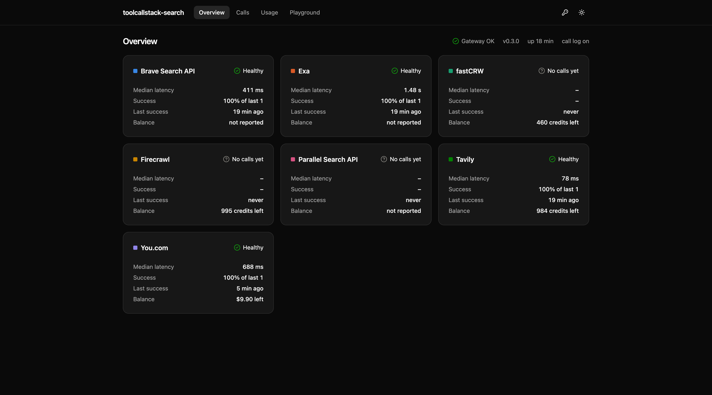
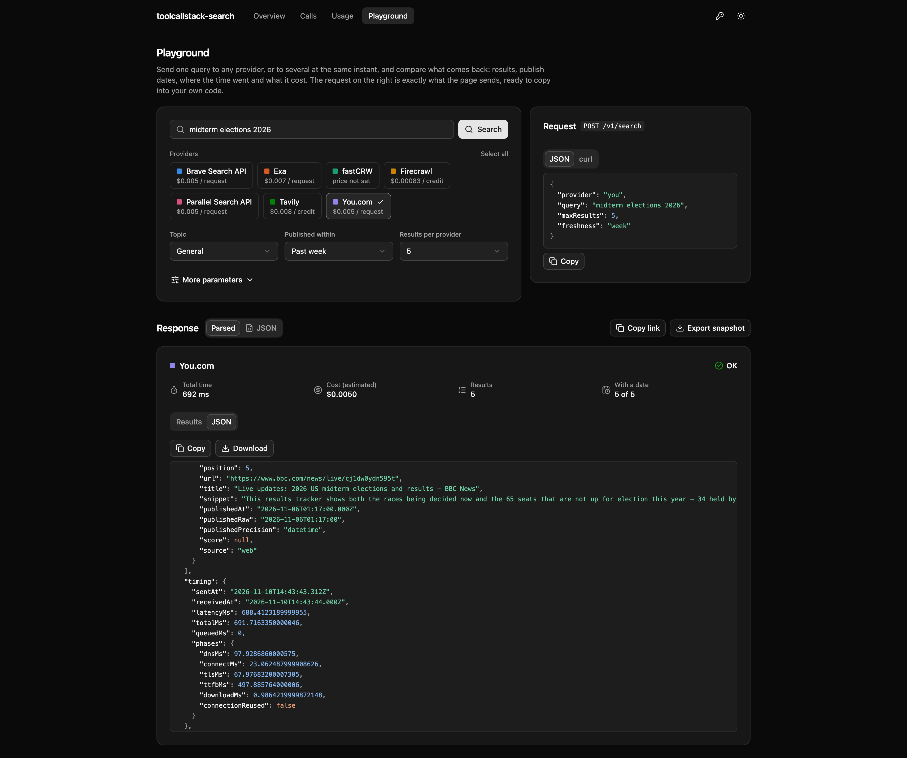
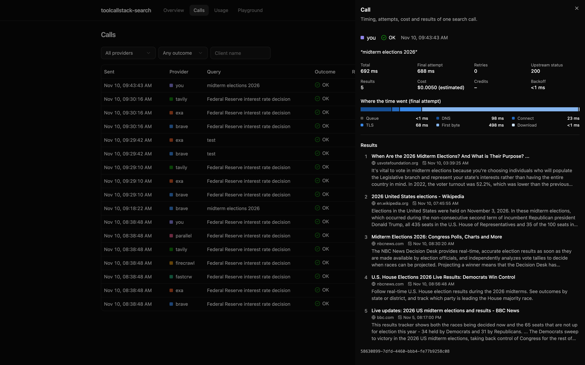

# toolcallstack-search

[](https://github.com/Viktor286/toolcallstack-search/actions/workflows/ci.yml)

A unified API gateway for web search providers: one request and response shape in front of Brave,
Exa, fastCRW, Firecrawl, Parallel, Tavily and You.com. Think LiteLLM, but for web search.

It is built for consumers that care about measurement as much as results. Every call reports where
its time went (queueing, DNS, connect, TLS, first byte, download), every retry it took, and what it
cost. A dashboard shows all of it.







## Quick start

Try it without installing anything or signing up anywhere:

```sh
docker run --rm -p 4310:4310 ghcr.io/viktor286/toolcallstack-search
```

Then open http://localhost:4310/ui/playground. With no provider key the gateway starts in
[demo mode](#demo-mode); pass keys with `-e BRAVE_API_KEY=...` (or `--env-file .env`) to search the
real web.

From source: requires Node 24 and pnpm. Postgres is optional; it enables the call log, balance snapshots,
`/v1/calls` and `/v1/usage`.

```sh
pnpm install
cp .env.example .env        # add provider keys
createdb toolcallstack_search          # optional
pnpm dev                    # gateway on :4310 (API docs at /docs), dashboard on :4311
pnpm smoke                  # one real query to every configured provider
```

```sh
curl -s localhost:4310/v1/search -H 'content-type: application/json' \
  -d '{"provider":"brave","query":"Federal Reserve rate decision","maxResults":5}'
```

With Docker (or OrbStack): `docker compose up --build` starts Postgres and the gateway, with a
container health check on `/health`. Provider keys are read from `.env` when it exists.

### Demo mode

While no provider has an API key, the gateway offers two built-in providers, `demo-a` and `demo-b`.
They answer with results the gateway generates itself: nothing is sent anywhere and nothing is
billed, and every link points at a reserved `example.*` host. They go through the same pipeline as
a real provider, so the API, call log, metrics, dashboard and playground all behave as usual.

The two differ on purpose: `demo-a` is fast and honours every parameter, `demo-b` is slower,
supports fewer parameters and leaves half its results undated. `options.latencyMs` sets the
response time and `options.status` (for example `503`) makes a call fail, which shows what retries
look like in the response:

```sh
curl -s localhost:4310/v1/search -H 'content-type: application/json' \
  -d '{"provider":"demo-a","query":"anything","maxRetries":2,"options":{"status":503}}'
```

`DEMO_MODE` is `auto` by default (on only without real keys); `true` keeps the demo providers
beside real ones and `false` removes them.

## API

| Endpoint                | Purpose                                                             |
| ----------------------- | ------------------------------------------------------------------- |
| `POST /v1/search`       | Search with one provider, optionally falling back to others.        |
| `POST /v1/search/batch` | Send the same query to several providers at the same instant.       |
| `GET /v1/providers`     | Providers: configured or not, supported parameters, limits, prices. |
| `GET /v1/providers/:id` | One provider in detail, including notes on useful `options`.        |
| `GET /v1/status`        | Health of the gateway and of each provider.                         |
| `POST /mcp`             | MCP server for AI agents (Streamable HTTP).                         |
| `GET /v1/calls`         | Logged calls, newest first, with filters and cursor paging.         |
| `GET /v1/calls/:id`     | One logged call, with the raw upstream body when it was stored.     |
| `GET /v1/usage`         | Calls, cost and account balance change per provider and API key.    |
| `GET /v1/stats`         | Calls, failures, latency and cost per provider over time.           |
| `GET /ui`               | The dashboard, when it has been built.                              |
| `GET /docs`             | Swagger UI; the OpenAPI document is at `/docs/json`.                |
| `GET /metrics`          | Prometheus metrics.                                                 |
| `GET /health`, `/ready` | Liveness, and readiness including the database.                     |

Documentation endpoints for AI agents are listed [below](#for-ai-agents).

### Request

Parameters are provider-independent: `query`, `maxResults`, `topic` (`general` or `news`),
`freshness` (`hour` to `year`), `startDate`, `endDate`, `includeDomains`, `excludeDomains`,
`country`. A parameter a provider cannot honour is dropped and reported in `warnings`, never
silently. Anything provider-specific goes in `options`, which is deep-merged into the upstream
request unchanged.

Per-call controls:

| Field        | Default | Meaning                                                                     |
| ------------ | ------- | --------------------------------------------------------------------------- |
| `timeoutMs`  | 30000   | Timeout for each attempt.                                                   |
| `maxRetries` | 5       | Retries after a transient failure. `0` makes exactly one upstream request.  |
| `maxQueueMs` | 30000   | Longest wait for a slot under the provider's rate limit. `0` fails at once. |
| `fallbacks`  | none    | `/v1/search` only: providers to try in order when the previous one fails.   |
| `includeRaw` | false   | Return the untouched upstream body.                                         |

### Response

```jsonc
{
  "id": "…", // gateway call id, primary key in the call log
  "provider": "you",
  "label": "you",
  "ok": true,
  "results": [
    {
      "position": 1,
      "url": "…",
      "title": "…",
      "snippet": "…",
      "publishedAt": "2026-10-28T18:00:18.000Z", // normalised to UTC, or null
      "publishedRaw": "2026-10-28T18:00:18", // exactly what the provider said
      "publishedPrecision": "datetime", // datetime | date | relative
      "score": null,
      "source": "web",
    },
  ],
  "timing": {
    "sentAt": "…",
    "receivedAt": "…", // wall clock, final attempt
    "latencyMs": 812.4, // final attempt alone
    "totalMs": 812.9, // whole call: queueing, earlier attempts, backoff
    "queuedMs": 0.3, // waiting for a slot under the provider's rate limit
    "phases": {
      // consecutive; they add up to latencyMs
      "dnsMs": 21.0,
      "connectMs": 98.2,
      "tlsMs": 207.1, // null on a reused connection
      "ttfbMs": 478.0,
      "downloadMs": 1.1,
      "connectionReused": false,
    },
  },
  "retries": {
    "count": 0,
    "backoffMs": 0,
    "attempts": [
      // every upstream request made for this call, in order
      {
        "sentAt": "…",
        "queuedMs": 0.3,
        "latencyMs": 812.4,
        "phases": {},
        "upstreamStatus": 200,
        "error": null,
        "backoffMs": null,
      },
    ],
  },
  "usage": {
    "credits": 1, // as reported by the provider
    "costUsd": 0.007, // as reported by the provider
    "estimatedCostUsd": 0.005, // from the gateway's price table
    "costSource": "estimated", // reported | estimated | unknown: which figure to use
  },
  "upstream": { "status": 200, "requestId": "…" },
  "warnings": [],
  "error": null, // { type, message, upstreamStatus } when ok is false
  "fallback": { "tried": [] }, // providers that failed before this one answered
}
```

`/v1/search` answers with the same body on failure and a matching status:

| Status | `error.type`                                | Meaning                                                |
| ------ | ------------------------------------------- | ------------------------------------------------------ |
| 404    | `unknown_provider`                          |                                                        |
| 503    | `not_configured`                            | The provider's API key is not set.                     |
| 429    | `rate_limited`                              | The provider answered 429, after retries.              |
| 429    | `throttled`                                 | No slot within `maxQueueMs`; nothing was sent.         |
| 429    | `budget_exceeded`                           | The provider's spend cap is used up; nothing was sent. |
| 504    | `timeout`                                   |                                                        |
| 502    | `upstream_error`, `network`, `bad_response` |                                                        |

`/v1/search/batch` takes `providers` instead of `provider` and always answers 200 with one entry
per provider. An entry may be an object to run a labelled variant of the same provider:

```json
{
  "query": "Nvidia 8-K",
  "providers": [
    "tavily",
    "you",
    { "provider": "you", "label": "you+knowledge", "options": { "knowledge": "core" } }
  ]
}
```

### Retries

Timeouts, network errors, 429 and 5xx responses are retried up to 5 times with exponential backoff
and jitter (about 0.5 s doubling to 8 s, or the upstream's `Retry-After` if longer, capped at 8 s).
Other failures are returned at once. Send `"maxRetries": 0` when one call must be exactly one
upstream request.

### Rate limits

There are two separate limits.

**Outbound, per provider.** The gateway holds back what a provider would reject instead of sending
it and retrying. Each provider can have `rpm` (requests started in any rolling minute) and
`concurrency` (requests in flight). Calls over a limit wait in a FIFO queue; the wait is reported as
`timing.queuedMs`, and a call that cannot get a slot within `maxQueueMs` fails as `throttled`.
Built-in defaults are Tavily 100 rpm and fastCRW 120 rpm with 3 concurrent; set your plan's real
limits with `PROVIDER_LIMITS`. Limits are held in memory, so they apply per gateway process unless
[shared state](#running-several-instances) is on.

**Inbound, per client.** `INBOUND_RATE_LIMIT_RPM` caps requests per gateway API key (or per IP when
auth is off).

### Budgets

`PROVIDER_BUDGETS` caps what a provider may spend, so a free tier or a prepaid balance cannot be
drained by accident:

```json
{
  "tavily": { "daily": { "credits": 50 }, "monthly": { "usd": 5 } },
  "brave": { "daily": { "calls": 200 } },
  "firecrawl": { "minRemaining": 100 }
}
```

- `daily` and `monthly` cap successful calls, dollars (reported cost, else the list-price
  estimate) or reported credits, per UTC day and calendar month.
- `minRemaining` stops calls once the provider's reported account balance is at or below the
  value, in the provider's own unit. It needs a provider with a balance endpoint.
- A capped provider is not called: the call fails as `budget_exceeded` with a message saying which
  cap was hit and when it resets. Fallbacks move on to the next provider.
- Spend is restored from the call log at start, so a restart does not reset a budget. Without a
  database it counts from process start.
- Dollar and credit caps are only known once a call returns, so they can be overshot by the calls
  in flight at that moment. Call caps cannot.

Current spend against each cap is on `GET /v1/providers` and in the dashboard.

### Clients

An entry in `GATEWAY_API_KEYS` may be `name:token`, for example `alice:sk-1,ci:sk-2`. The name is
recorded with every call that token makes, so usage can be split per consumer:
`GET /v1/calls?client=alice` and `GET /v1/usage?groupBy=client`. A bare token still works and gets
a generated name. The inbound rate limit applies per client.

### Fallbacks

```json
{ "provider": "tavily", "fallbacks": ["brave", "you"], "query": "…" }
```

Providers are tried in order. Each gets its own retries, limits and call-log entry; the first
success is returned, with the failures listed in `fallback.tried`. If all fail, the last failure is
returned. Combine with `"maxQueueMs": 0` to move on at once when a provider is at its limit.

### Cost

Per call, `usage` carries what the provider reported and a list-price estimate from the gateway's
price table. Estimates ignore free credits, so providers are comparable.

| Provider  | Per-call figure       | Default price                                 | Balance endpoint                        |
| --------- | --------------------- | --------------------------------------------- | --------------------------------------- |
| Exa       | reports dollars       | $0.007 per request, $0.001 per result over 10 | with `EXA_SERVICE_KEY` (dollars used)   |
| Tavily    | reports credits       | $0.008 per credit                             | yes (credits)                           |
| Firecrawl | reports credits       | $0.00083 per credit (Standard plan; varies)   | yes (credits)                           |
| Parallel  | reports request count | $0.005 per request, $0.001 per result over 10 | with `PARALLEL_ACCOUNT_TOKEN` (dollars) |
| You.com   | nothing               | $0.005 per request                            | yes (dollars)                           |
| Brave     | nothing               | $0.005 per request                            | no                                      |
| fastCRW   | nothing               | none set (2 credits per search)               | yes (credits)                           |

Prices are defaults taken from public pricing pages and should be checked against your plan;
override them with `PROVIDER_PRICING`.

For ground truth, the gateway snapshots each provider's account balance every
`BALANCE_POLL_SECONDS`. `GET /v1/usage?from=…&to=…` then reports, per provider and API key (shown as
a short fingerprint, never the key):

- calls, upstream requests, and reported and estimated cost from the call log;
- the latest balance, and `balance.window.spent`: the real change between the first and last
  snapshot in the window, with `spentPerOkCall` to compare against the price table.

Exa and Parallel only expose account data to a separate credential: an Exa service key
(dashboard, "Service keys" tab) and a Parallel OAuth account token. Without them those two rely on
per-call figures. Brave has no account endpoint.

The balance change also includes any use of the same key outside the gateway, and some providers
update their counters with a delay, so compare over windows of minutes or more.

### Health

- `GET /health` answers 200 while the process serves requests. Use it for liveness probes; the
  Docker image does.
- `GET /ready` also checks the database.
- `GET /v1/status` reports each provider as `healthy`, `degraded`, `down` or `unknown`, from the last
  20 real calls since the process started (or, with shared state, across all instances): `down` after 3 failures in a row, `degraded` after a
  failure or below 80% success. It also gives success rate, median latency, the last error and queue
  depth. `?probe=true` first sends one live one-result search to every configured provider, which
  spends provider credits.

## Dashboard

`apps/dashboard` is a React app (Vite, shadcn/ui, TanStack Query) over the gateway's own API.

| Page       | Shows                                                                                  |
| ---------- | -------------------------------------------------------------------------------------- |
| Overview   | Gateway status and, per provider, health, latency, balance and budget use.             |
| Calls      | The call log with filters; a call opens to its timing breakdown, attempts and results. |
| Usage      | Calls over time, typical latency and cost per provider, and the per-key cost check.    |
| Playground | Run a query against one provider or several at once and compare.                       |

`pnpm dev` serves it on port 4311 against the local gateway. `pnpm build` writes
`apps/dashboard/dist`, which the gateway then serves at `/ui`; the Docker image includes it. When
the gateway requires an API key the dashboard asks for it once and keeps it in the browser's local
storage. Calls, Usage and balances need `DATABASE_URL`; Overview and Playground work without it.

## For AI agents

These endpoints need no key and are generated from the same provider registry and schemas the
gateway runs on, so they always match its behaviour.

| Endpoint                  | Content                                                                    |
| ------------------------- | -------------------------------------------------------------------------- |
| `/llms.txt`               | Short Markdown index: what the API is and where everything else lives.     |
| `/llms-full.txt`          | The full guide in one Markdown page: endpoints, fields, errors, providers. |
| `/docs/providers/{id}.md` | One provider: supported parameters, limits, cost, useful `options`.        |
| `/openapi.json`           | OpenAPI document for all endpoints.                                        |
| `/schemas/{name}.json`    | JSON Schema for one request or response; `/schemas` lists the names.       |
| `/tools.json`             | A ready-made `web_search` tool definition for Anthropic, OpenAI and MCP.   |

### MCP server

`POST /mcp` is a Model Context Protocol server over Streamable HTTP, so an MCP client can use the
gateway directly as a tool server. It needs the gateway API key like the rest of `/v1`, sent as a
bearer token. It keeps no session, so any gateway instance can serve any request.

| Tool               | What it does                                                              |
| ------------------ | ------------------------------------------------------------------------- |
| `web_search`       | One provider, with optional `fallbacks`. Same arguments as `/tools.json`. |
| `web_search_batch` | The same query to several providers at once, results kept per provider.   |
| `list_providers`   | Providers, which are configured, what each supports, limits and notes.    |

Results come back as text a model can read directly (title, URL, publish date, snippet, warnings),
with the full unified response attached as structured content.

```sh
claude mcp add --transport http toolcallstack-search http://localhost:4310/mcp
```

An agent that is given only the gateway's address can start at `/llms.txt`. To give a model web
search, pass it the definition from `/tools.json` and send the tool arguments as the body of
`POST /v1/search`.

## Adding a provider

1. Copy a file in `apps/gateway/src/providers/` (`tavily.ts` is a good template). A provider is two
   pure functions, `buildRequest` and `parseResponse`, plus the unified parameters it honours and,
   `notes` for callers and, optionally, its default `limits`, `pricing` and `balance` endpoint.
2. Add it to the array in `apps/gateway/src/providers/index.ts`.
3. Add its key to `.env` and a case to `apps/gateway/test/providers.test.ts`.

Transport, timing, retries, limits, cost, metrics and storage are shared and live in
`apps/gateway/src/search.ts`.

## Observability

- **Logs**: structured JSON (pino), one `search call` line per call, with the `traceId` when tracing
  is on.
- **Traces**: set `OTEL_EXPORTER_OTLP_ENDPOINT` (for example `http://localhost:4318`) and the gateway
  exports OpenTelemetry traces over OTLP/HTTP; unset, tracing is off. An incoming `traceparent`
  header is continued, so a search shows up inside the caller's own trace. Each call is a
  `search <provider>` span (results, retries, queue wait, cost, error type) with one
  `upstream <provider>` child per attempt carrying the status and the DNS, connect, TLS, first-byte
  and download times; retries are events on the search span. The query text is never put on a span.
  The standard `OTEL_SERVICE_NAME`, `OTEL_EXPORTER_OTLP_HEADERS` and `OTEL_SDK_DISABLED` apply. To
  look at traces locally: `docker run -p 16686:16686 -p 4318:4318 jaegertracing/jaeger`.
- **Metrics** at `/metrics`:
  - `toolcallstack_search_upstream_calls_total{provider,outcome}`, `toolcallstack_search_upstream_retries_total{provider,reason}`
  - `toolcallstack_search_upstream_duration_seconds`, `toolcallstack_search_upstream_ttfb_seconds`, `toolcallstack_search_upstream_results`
  - `toolcallstack_search_queue_wait_seconds`, `toolcallstack_search_queue_depth`
  - `toolcallstack_search_cost_usd_total{provider,source}`, `toolcallstack_search_balance{provider,unit}`
  - `http_request_duration_seconds` per route, and Node.js runtime metrics
- **Privacy of the call log**: string values under keys that look like credentials (`apiKey`,
  `token`, `secret`, `password`, `authorization`) in a caller's `options` are stored as
  `[redacted]`; the provider still receives the real value. Provider API keys are never stored.
- **Call log**: with `DATABASE_URL` set, every call is written to `gateway.search_calls` (params,
  timing, attempts, results, usage; raw bodies too with `STORE_RAW=true`) and is readable through
  `/v1/calls`. Writes happen off the request path so the database never delays a measurement.
- **Load shedding**: while the event loop lags by more than `MAX_EVENT_LOOP_DELAY_MS` the gateway
  answers 503, because timings taken then would be skewed.

## Running several instances

One instance keeps its rate limits, budgets and provider health in memory. To run more than one
behind a load balancer, set `SHARED_STATE=true` on all of them, with the same `DATABASE_URL`:

- **Outbound rate limits** are counted in Postgres, so `rpm` and `concurrency` hold for all
  instances together. A waiting call polls for a slot, so order between instances is not strictly
  first-come, and each upstream request costs one extra database round trip.
- **Budgets and provider health** are reloaded from the shared call log every
  `SHARED_STATE_SYNC_SECONDS`. A budget can therefore be overshot by what the other instances send
  within that interval.
- **Inbound limits** (`INBOUND_RATE_LIMIT_RPM`) and the queue-depth metric stay per instance.

The MCP endpoint is stateless and the call log is shared already, so nothing else needs care.

## Configuration

| Variable                        | Default           | Meaning                                                                      |
| ------------------------------- | ----------------- | ---------------------------------------------------------------------------- |
| `PORT`, `HOST`                  | `4310`, `0.0.0.0` |                                                                              |
| `GATEWAY_API_KEYS`              | empty             | Comma-separated bearer tokens, optionally `name:token`. Empty disables auth. |
| `DATABASE_URL`                  | unset             | Postgres. Migrations run at start.                                           |
| `STORE_RAW`                     | `false`           | Store raw upstream bodies in the call log.                                   |
| `DEMO_MODE`                     | `auto`            | Built-in demo providers: `auto` (only without real keys), `true`, `false`.   |
| `SHARED_STATE`                  | `false`           | Share limits, budgets and health between instances. Needs `DATABASE_URL`.    |
| `SHARED_STATE_SYNC_SECONDS`     | `10`              | How often budgets and health are reloaded from the call log.                 |
| `OTEL_EXPORTER_OTLP_ENDPOINT`   | unset             | OTLP/HTTP endpoint for traces. Unset turns tracing off.                      |
| `DEFAULT_TIMEOUT_MS`            | `30000`           | Per-attempt timeout when the request sets none.                              |
| `MAX_RETRIES`                   | `5`               | Retries per call when the request sets none.                                 |
| `RETRY_BASE_MS`, `RETRY_MAX_MS` | `500`, `8000`     | First backoff step and the cap on any single wait.                           |
| `PROVIDER_LIMITS`               | `{}`              | JSON by provider id: `{"tavily":{"rpm":100,"concurrency":10}}`.              |
| `MAX_QUEUE_MS`                  | `30000`           | Queue wait limit when the request sets none.                                 |
| `PROVIDER_PRICING`              | `{}`              | JSON by provider id: `{"brave":{"perRequestUsd":0.005}}`.                    |
| `PROVIDER_BUDGETS`              | `{}`              | JSON by provider id: spend caps, see [Budgets](#budgets).                    |
| `CALL_LOG_RETENTION_DAYS`       | `0`               | Delete logged calls and balance snapshots older than this. `0` keeps them.   |
| `RAW_RETENTION_DAYS`            | `0`               | Drop stored raw upstream bodies older than this. `0` keeps them.             |
| `BALANCE_POLL_SECONDS`          | `300`             | Balance snapshot interval. `0` disables. Needs `DATABASE_URL`.               |
| `INBOUND_RATE_LIMIT_RPM`        | `0`               | Requests per minute per gateway API key. `0` disables.                       |
| `MAX_EVENT_LOOP_DELAY_MS`       | `1000`            | Load-shedding threshold. `0` disables.                                       |
| `LOG_LEVEL`                     | `info`            |                                                                              |

Provider keys and their variable names are listed in [.env.example](.env.example).

## Development

```sh
pnpm check       # lint (oxlint), format check (oxfmt), typecheck, tests
pnpm fmt         # format
TEST_DATABASE_URL=postgres://localhost:5432/toolcallstack_search_test pnpm test   # include database tests
```

The gateway has no build step: Node runs its TypeScript sources directly. Only the dashboard is
built (`pnpm build`). The app is assembled from
Fastify plugins in `apps/gateway/src/app.ts`; routes live in `apps/gateway/src/routes/`.

See [CONTRIBUTING.md](CONTRIBUTING.md) for the workflow and [SECURITY.md](SECURITY.md) for
deployment notes. Licensed under the [MIT License](LICENSE).
